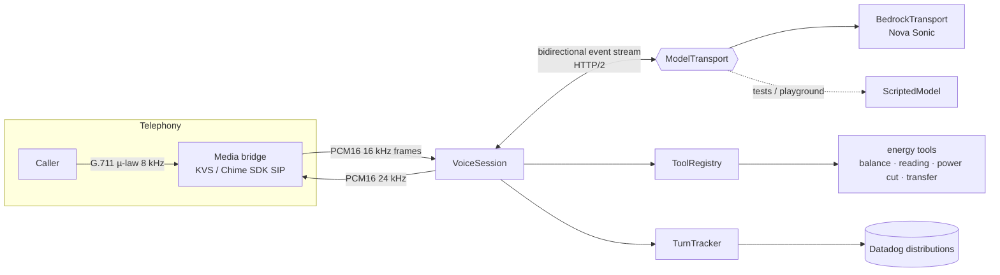
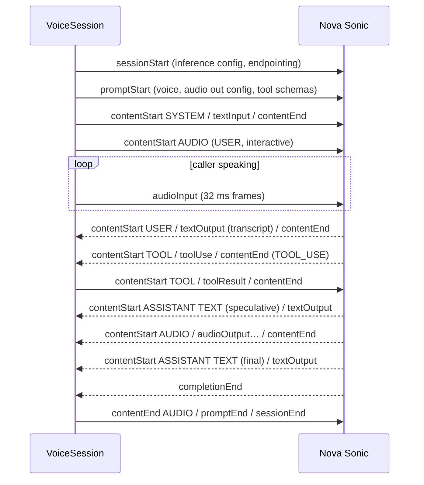

# Architecture

## Pieces

| Module | Responsibility |
|---|---|
| `protocol/events.ts` | The only place raw events are built or parsed. Input builders, output parser, barge-in detection. |
| `session/session.ts` | One call. Opens scopes in order, streams audio, routes output, runs tools, tracks history, renews the connection. |
| `session/transport.ts` | `ModelTransport` interface: an async iterable of JSON strings in, the same out. |
| `session/bedrock-transport.ts` | `InvokeModelWithBidirectionalStreamCommand` over an HTTP/2 handler. Maps modelled stream exceptions to errors. |
| `session/scripted-model.ts` | Protocol-faithful fake for tests and the playground. Same event shapes, timings configurable. |
| `tools/registry.ts` | Validation (zod), timeouts with `AbortSignal`, structured errors. Never throws into the session. |
| `latency/turn-tracker.ts` | Time to first audio, tool round trips, barge-ins, per turn. |
| `audio/pcm.ts` | µ-law decode/encode, resampling, framing. |

## Event lifecycle

## Things that bite in production

- **Speculative vs final text.** The assistant's text arrives twice. Use the speculative version for live captions and the final version for history and analytics. Mixing them up duplicates every reply in the transcript.
- **Barge-in is a text event.** The interruption arrives as `textOutput` with `{ "interrupted": true }`. The playback buffer on the telephony side must be flushed right away, or the caller hears the old answer under their own voice.
- **Silence keeps the stream alive.** With a prompt open and no `audioInput` for a while, the service closes the stream. Bridges must keep sending frames, silence included.
- **Connection limit.** About 8 minutes per connection. `VoiceSession` renews at 7 by default, never mid-sentence. It replays the system prompt and the last 12 turns as non-interactive text.
- **Telephony audio is narrowband.** 8 kHz µ-law upsampled to 16 kHz adds no information, but the model expects 16 kHz. Don't run a denoiser tuned for wideband on it.
- **Tool latency is dead air.** The system prompt asks for a holding phrase before data lookups. That hides a 300-600 ms tool call behind speech the caller expects anyway.
